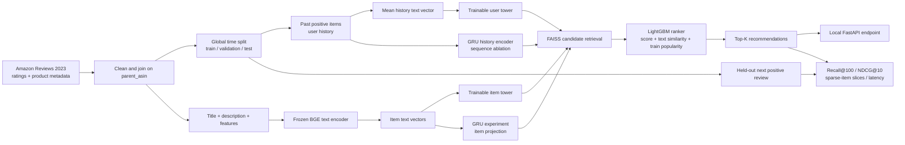

# Amazon Video Games: text-enhanced recommendation

A reproducible two-stage recommendation experiment on the **Amazon Reviews 2023 / Video_Games** category. The question is whether product text improves next-item recommendation, especially for items with few training interactions. The system uses historical ratings as an interaction proxy. It does **not** observe clicks, purchases, impressions, or sales lift.

**Status:** the data pipeline, retrieval models, reranker, evaluation, and local API have been run on the public data. The raw dataset, text encoder weights, embeddings, and fitted models are generated locally and excluded from Git.



## Data and evaluation contract

The [McAuley Lab dataset](https://amazon-reviews-2023.github.io/main.html) provides ratings with user, item, and timestamp IDs plus product metadata. The official [5-core Video_Games file](https://amazon-reviews-2023.github.io/data_processing/5core.html) has about 814.6k ratings, 94.8k users, and 25.6k items. We use the authors' global timestamp cutoffs: train before `1628643414042`, validation before `1658002729837`, and test afterward. A rating of at least four stars is a positive action. Each evaluation user contributes the first qualifying positive event in that split, provided there is a prior positive history. Candidate results exclude previously positive items and items whose first observed review occurs after the target event.

Product `average_rating` and `rating_number` are excluded because they aggregate reviews across time. The item encoder sees title, description, and feature text. Product metadata is a 2023 snapshot rather than historical snapshots, so title/description edits after an event cannot be ruled out. This is a limitation of the public dataset. Unreviewed candidates are **unknown**, not confirmed negatives; ranking results are offline proxy measurements.

## Models and experiments

| System | Purpose |
| --- | --- |
| Training-set popularity | Sanity baseline |
| Train-only item-item collaborative filtering | Measure the value of behavior without text |
| Frozen BGE text cosine | Test whether item text alone helps |
| Two-Tower on frozen BGE vectors | Learn separate user-history and item projections using in-batch contrastive loss |
| 50/50 text + Two-Tower hybrid | Preserve content matching while adding learned behavioral signal |
| GRU sequence tower + frozen text hybrid | Test whether the order of positive history improves candidate retrieval |
| FAISS FlatIP and HNSW | Compare exact retrieval with approximate search |
| LightGBM LambdaRank | Reorder the retrieved 100 candidates using only training-time popularity and current request features |

The ranker trains on the earlier half of validation queries and uses the later half for stopping. The test cohort is used for reporting. We measure candidate Recall@100 and final NDCG@10. The top-level comparison is popularity → item CF → content → Two-Tower → hybrid → hybrid + ranker. Follow-up ablations are title-only vs full product text and history length. Sparse-item buckets use training interaction count. FAISS FlatIP versus HNSW is measured separately.

### Held-out test results

These measurements use all **11,470** eligible test users and one future positive review per user. Higher is better. Full protocol and file hashes are in [validation notes](docs/validation.md).

| System | Recall@100 | Recall@10 | NDCG@10 |
| --- | ---: | ---: | ---: |
| Popularity | 1.99% | 0.58% | 0.27% |
| Item CF | 1.94% | 0.65% | 0.33% |
| Frozen text cosine, FlatIP | 6.57% | 1.42% | 0.75% |
| Learned Two-Tower, FlatIP | 5.52% | 0.91% | 0.40% |
| Hybrid, HNSW | 7.27% | 1.64% | 0.84% |
| GRU sequence hybrid, HNSW | 7.68% | 1.73% | 0.91% |
| Hybrid + LambdaRank, HNSW | 7.27% | 2.26% | 1.13% |

The Two-Tower alone underperformed frozen text matching. The GRU hybrid improved candidate Recall@100 by 0.41 percentage points over the mean-history hybrid on test; its 0.09-point Recall@10 gain was not compelling in a paired query comparison. The ranker shown here is fitted to the mean-history hybrid, **not** the GRU candidates, so these rows do not describe a combined GRU + ranker pipeline. Reranking helped items with zero positive training events but reduced top-10 recall in the 1–4 and 5+ training-event buckets. The current ranker is a five-feature LightGBM tree ensemble fitted from only 403 early-validation queries with a retrieved positive; it is an exploratory baseline, not a robust final ranker.

The median eligible catalog has 24,868 items. Uniformly random ranking would reach about 0.40% Recall@100 and 0.040% Recall@10 under this one-target protocol; popularity reaches 1.99% and 0.58%. This makes 7.68% meaningfully above trivial baselines but still leaves most next-positive items outside the 100 candidates. The results are offline proxy measurements, not online user-impact measurements. Because we inspected test results before adding the GRU model, its test comparison is exploratory; the full validation result and protocol are in the [validation notes](docs/validation.md).

## Reproduce

Python 3.10+; the text encoder is downloaded from Hugging Face on first run. A CUDA GPU speeds up encoding and tower training, but CPU is supported. Windows systems with local enterprise CAs can use Python `truststore` for official dataset downloads; TLS verification stays on.

```bash
python -m venv .venv
.venv/Scripts/python -m pip install -e ".[test]"
.venv/Scripts/amazon-recsys download
.venv/Scripts/amazon-recsys prepare
.venv/Scripts/amazon-recsys encode
.venv/Scripts/amazon-recsys train-towers
.venv/Scripts/amazon-recsys train-sequence
.venv/Scripts/amazon-recsys train-itemcf
.venv/Scripts/amazon-recsys evaluate --split valid --mode popular
.venv/Scripts/amazon-recsys evaluate --split valid --mode itemcf
.venv/Scripts/amazon-recsys evaluate --split valid --mode content
.venv/Scripts/amazon-recsys evaluate --split valid --mode tower
.venv/Scripts/amazon-recsys evaluate --split valid --mode sequence_hybrid --index flat --alpha 0.5 --max-queries 0
.venv/Scripts/amazon-recsys train-ranker
.venv/Scripts/amazon-recsys benchmark-index
.venv/Scripts/amazon-recsys evaluate --split test --mode hybrid --index hnsw --alpha 0.5 --max-queries 0 --ranker
.venv/Scripts/amazon-recsys serve
.venv/Scripts/python -m pytest -q
```

On Linux or macOS, use `.venv/bin/python` and `.venv/bin/amazon-recsys`. `--max-queries 0` evaluates every eligible user. The default sample is deterministic for development. Downloaded files, derived Parquet, embeddings, and checkpoints stay under ignored `data/` and `artifacts/`.

The local API serves `POST /recommend` with `{"history_asins":["B000000000"],"top_k":10}`; use ASINs from the downloaded catalog. Open `/docs` for the interactive schema. At startup it loads the local text vectors, tower checkpoint, FAISS index, and optional ranker. The API is a local demonstration; its end-to-end request latency has not been characterized as a service-level target.

## Source

Yupeng Hou et al., *[Bridging Language and Items for Retrieval and Recommendation](https://arxiv.org/abs/2403.03952)*, 2024. Dataset and benchmark processing by [McAuley Lab](https://amazon-reviews-2023.github.io/). This repository is an independent portfolio implementation; it does not claim to reproduce the paper's published scores.
